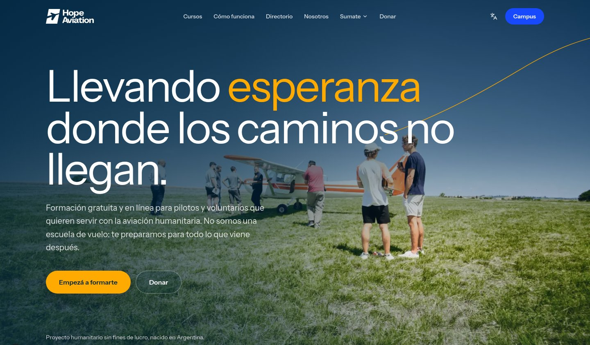

<div align="center">

<picture>
  <source media="(prefers-color-scheme: dark)" srcset="public/logos/Hope%20Aviation%20White.png">
  
</picture>

<p><strong>Website and virtual campus for a non-profit humanitarian aviation project.</strong></p>

[](https://nextjs.org)
[](https://react.dev)
[](https://www.typescriptlang.org)
[](https://supabase.com)
[](https://tailwindcss.com)


</div>

<p align="center">
  
</p>

Hope Aviation prepares pilots and volunteers to serve isolated communities through aviation in Argentina and South America.

> Hope Aviation is **not a flight school** and does not issue licenses. The campus offers complementary training (technical, humanitarian and spiritual) for mission and humanitarian aviation.

## Features

**Public site**
- Landing, about, get involved, donations and newsletter sign-up.
- Directory of mission aviation organizations around the world (`/directorio`).
- Public certificate verification by code (`/certificados/[codigo]`).
- Spanish and English.

**Campus** (`/campus`, sign-in with email/password or Google)
- Course → Subjects → Classes (video, resources) → Exams.
- Lesson progress, exams unlocked module by module, a final exam and certificates.
- Student profile and certificates page.

**Staff tools** (`/campus/admin`)
- Instructors and admins manage courses, exams and people.
- Admin-only newsletter management.
- Access is enforced with Row Level Security in Postgres, API guards and UI guards (see [Roles & security](#roles--security)).

## Stack

- Next.js 16 (App Router, Turbopack, `cacheComponents`), React 19, TypeScript
- Supabase: Postgres + Auth (email/password, Google) + Row Level Security
- Tailwind CSS v4 + shadcn/ui-style components (`components/ui`)
- Resend for email (newsletter)
- pnpm

## Getting started

Requires Node.js 24 (see `.nvmrc`) and pnpm.

```bash
pnpm install
cp .env.example .env.local   # fill in Supabase, Google and Resend values
pnpm dev                     # http://localhost:3000
```

To run against a local Supabase instead of the cloud project:

```bash
pnpm dev:local               # starts Supabase locally, runs Next.js, stops Supabase on exit
```

## Scripts

| Script | What it does |
|--------|--------------|
| `pnpm dev` / `pnpm build` / `pnpm start` | Next.js dev server, production build, production server |
| `pnpm lint` | ESLint |
| `pnpm db:start` / `db:stop` / `db:status` | Local Supabase |
| `pnpm db:reset` | Recreate the local DB from migrations + seeds |
| `pnpm db:push` | Apply new migrations to the linked project |
| `pnpm db:migration:new <name>` | Create a migration |
| `pnpm db:types:linked` / `db:types:local` | Regenerate `types/supabase.generated.ts` |
| `pnpm test:unit` | Unit tests (Node test runner) |
| `pnpm test:db` | Database tests against local Supabase |
| `pnpm content:build content/courses/<slug>` | Build a course's SQL seed from `content/` |

## Project layout

```
app/                 routes (landing, /auth, /campus, /api)
  campus/admin/      staff tools (admins + instructors); (admin-only)/ = admins only
actions/             server actions
components/ui/       base components (Button, Badge, Input…)
components/shared/   navbar, footer, modal, table…
components/features/ domain components (admin, campus, landing)
lib/                 supabase clients, API helpers, validation (zod), i18n
supabase/migrations/ schema, RLS policies, RPCs (source of truth for the DB)
types/               database types
```

## Roles & security

Roles live in `roles` + `roles_users` (`admin`, `instructor`, `student`). Authorization is layered:

1. **RLS** on every `public` table (primary layer, uses `public.has_role`).
2. **API guards** in `lib/api/auth.ts` (`requireSession`, `requireStaff`, `requireAdmin`) on every mutating route.
3. **UI guards**: `app/campus/admin/layout.tsx` (staff) and `app/campus/admin/(admin-only)/layout.tsx` (admin), plus role-filtered navigation.

Never expose the Supabase service-role key to the client.

## Docs

- `DESIGN.md` — design system (Hope identity + structural system). Visual reference at `/componentsdev`.
- `GEMINI.md` — conventions for AI assistants and contributors (English comments, structure, security).
- `AGENTS.md` — database/backend workflow.
